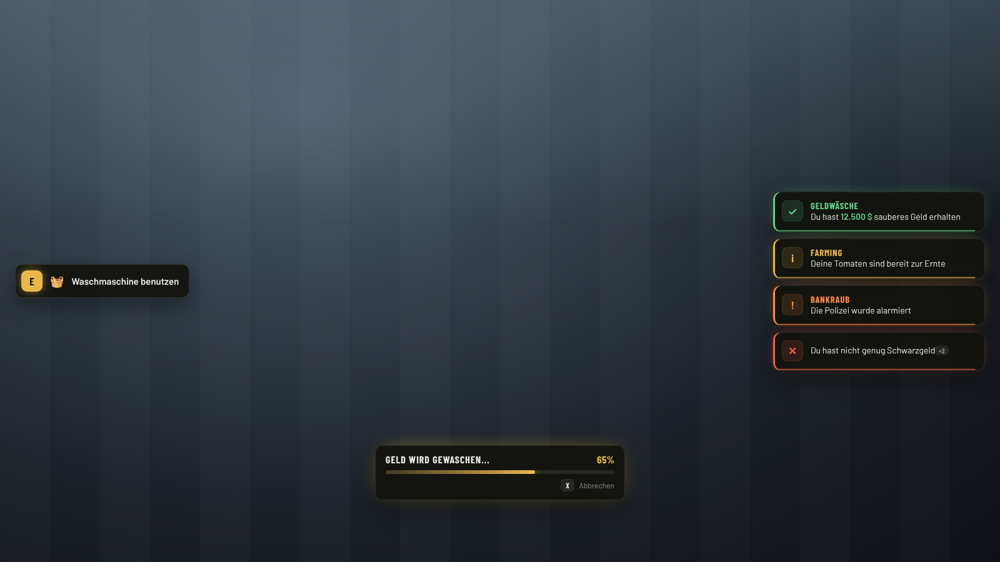
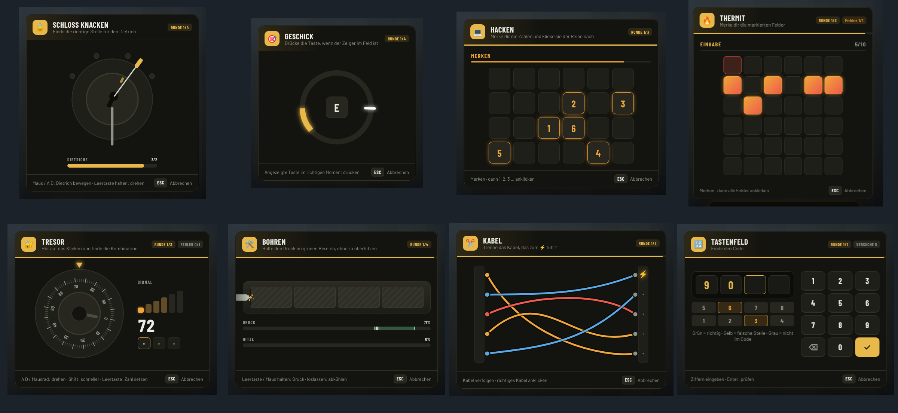

<div align="center">

# lafl_lib

**Free shared library for FiveM – one look for every script.**

Notify · Progress bar · Text UI · 3D labels · 8 minigames · Framework bridge


**[⬇ Download the latest release](../../releases/latest)**

</div>



## Why lafl_lib?

Most servers end up with five different notify styles, three progress bars and a mix of target eyes and "Press E" boxes.
lafl_lib gives all of them **one clean, modern design** – for your own scripts **and** for the ones you already use –
on ESX, QBCore and Qbox. Made for the **LA for Life (LAFL)** scripts, free for everyone.

## Features

- 🔔 **Notify** – dark, minimal, with title, icon and GTA colour codes (`~g~`, `~r~` …). Position, duration and sound in the config.
- ⏳ **Progress bar** – animations, props, cancel with X, controls disabled while busy.
- ⌨️ **Text UI** – "[E] Open" hints with key boxes. Understands `Press [E] to …`, `E - Open Garage` and `~INPUT_CONTEXT~` automatically.
- 🏷️ **3D labels** – LAFL-styled labels in the world, for your scripts and for framework 3D text (e.g. Qbox housing doors).
- 🎯 **No target script needed** – interactions as text UI or 3D label (`textui` / `text3d`), or use ox_target / qb-target.
- 🎮 **8 minigames** for robbery scripts – lockpick, skill check, hack, thermite, safe, drill, wires, keypad – with a server-side check.
- 🔁 **Use it for ALL scripts** – drop-in replacement folders for ESX and QBCore, plus short guides for qb-core, ox_lib and Qbox.
- 🧩 **Framework bridge for developers** – player, job, inventory, money, company accounts, police count, callbacks, database, security, Discord logs.
- 🌍 **English and German**, everything in one config, nothing auto-detected, nothing loaded from the internet.



## Compatibility

| | Supported |
|---|---|
| **Frameworks** | ESX Legacy · QBCore · Qbox · standalone |
| **Inventories** | ox_inventory · qb-inventory · ESX inventory · custom |
| **Target** | ox_target · qb-target · none (`textui` / `text3d`) |
| **Notify / progress / text UI** | LAFL design, or forward to ox_lib · qb · esx · native · custom |
| **Dispatch** | built-in · ps-dispatch 1.x + 2.x · cd_dispatch · custom |
| **Company accounts** | qb-banking · Renewed-Banking · esx_addonaccount · custom |
| **Database** | oxmysql |

## LAFL design for every script

| | ESX | QBCore | Qbox |
|---|---|---|---|
| Notify | replacement folder | 1 function in qb-core | 1 block in ox_lib |
| Progress bar | replacement folder | replacement folder | 1 block in ox_lib |
| "[E]" hint | replacement folder | 3 small blocks in qb-core | 2 blocks in ox_lib |
| 3D text | 1 line in es_extended | 1 line in qb-core | 1 line in qbx_core |

Step by step: **[installation guide](lafl_lib/README.md#lafl-design-for-all-scripts)**.

## Quick start

1. Download the **[latest release](../../releases/latest)** and copy `lafl_lib` into your `resources`.
2. Add `ensure lafl_lib` to your `server.cfg` (after your framework, before the scripts that use it).
3. Set your framework, inventory and target in `lafl_lib/config.lua` and restart.

Test it with `LibConfig.Debug = true`: `/lafltest notify`, `/lafltest progress`, `/lafltest thermite hard`.

## For developers

```lua
-- fxmanifest.lua
dependency 'lafl_lib'
shared_script '@lafl_lib/init.lua'

-- client
LAFL.Notify('Vehicle locked', 'success')
if LAFL.Progress({ duration = 5000, label = 'Repairing', canCancel = true }) then ... end
local won = LAFL.Minigame.Start('lockpick', { difficulty = 'medium' })

-- server
if LAFL.Money.Remove(src, 'bank', 500, 'repair') then LAFL.Inventory.Add(src, 'repairkit', 1) end
```

Or without including it: `exports.lafl_lib:Notify(...)`, `exports.lafl_lib:Progress(...)`, `exports.lafl_lib:Minigame(...)`.
Full API reference: **[guide → For developers](lafl_lib/README.md#for-developers)**.

## Documentation

- 📘 **[Full guide](lafl_lib/README.md)** – installation, config, every framework, troubleshooting, API
- 🇩🇪 [Deutsche Anleitung](lafl_lib/README.de.md)

## License

**GNU LGPL-3.0** (`LICENSE`, based on the GPL-3.0 in `COPYING`).
Use it for free in free **and** paid scripts. If you change lafl_lib itself and share it, your changes must stay open under the same license and keep the credits.

Fonts: Barlow by Jeremy Tribby (SIL Open Font License). Made by **G-Star** for **LA for Life**.
