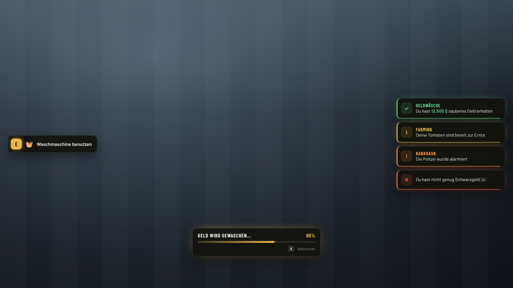
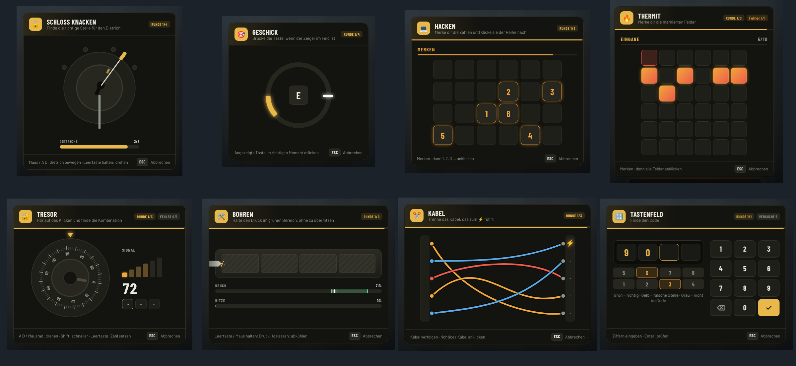

# lafl_lib

Kostenlose Bibliothek für FiveM – gemacht für die **LA for Life (LAFL)** Skripte, nutzbar in jedem Skript.
Eine Bridge für ESX / QBCore / Qbox / Standalone, modernes Notify, Fortschrittsbalken und Text-UI und **8 Minispiele für Raub-Skripte**.

**🇬🇧 [English guide → README.md](README.md)**





## Funktionen

- **Eine Bridge** – ESX, QBCore, Qbox, Standalone · ox_inventory, qb-inventory, ESX-Inventar · ox_target, qb-target oder keins.
- **LAFL-Notify, Fortschrittsbalken, Text-UI** – ohne ox_lib, und mit dem Ordner `extras` für **alle** deine Skripte.
- **8 Minispiele** – Schloss knacken, Geschick, Hacken, Thermit, Tresor, Bohren, Kabel, Tastenfeld – mit Server-Prüfung.
- **Geld, Dispatch, Datenbank, Sicherheit, Discord-Logs** und ein **UI-Kit** für eigene Menüs.
- Nichts wird automatisch erkannt, nichts aus dem Internet geladen.

## Installation

1. Download entpacken. Den Ordner `lafl_lib` in `resources` kopieren (Name genau `lafl_lib`, nicht `lafl_lib-main`).
2. `server.cfg` – nach Framework / Inventar / Target, **vor** den Skripten, die es nutzen:
   ```cfg
   ensure lafl_lib
   ```
3. `lafl_lib/config.lua` einstellen:
   ```lua
   LibConfig.Framework = 'qb'      -- 'esx' | 'qb' | 'standalone'   (Qbox = 'qb')
   LibConfig.Inventory = 'ox'      -- 'ox' | 'qb' | 'esx' | 'custom'
   LibConfig.Target    = 'ox'      -- 'ox' | 'qb' | 'textui' | 'text3d' (kein Target-Skript nötig)
   LibConfig.Notify    = 'lafl'
   LibConfig.Progress  = 'lafl'
   LibConfig.TextUI    = 'lafl'
   LibConfig.Text3D    = 'lafl'    -- 3D-Text anderer Skripte: 'lafl' | 'textui' | 'original'
   LibConfig.Locale    = 'de'      -- 'de' | 'en'
   ```
   Kein ox_target / qb-target? `'textui'` zeigt „[E] …“ am Bildschirmrand, `'text3d'` als Schild am Objekt – für alle LAFL-Skripte auf einmal.
   Mehrere Optionen an einer Stelle zeigen `⇅ 1/2` (Option 1 von 2) – mit dem **Mausrad** oder den Pfeiltasten wechseln, dann E drücken. Dispatch, Firmenkonten und mehr sind in der Datei erklärt. Ein falscher Wert wird in der Server-Konsole gemeldet.
4. Server neu starten. Testen mit `LibConfig.Debug = true`: `/lafltest notify`, `/lafltest progress`, `/lafltest textui`, `/lafltest thermite hard`.

LAFL-Skripte nutzen das LAFL-Design automatisch. Für **alle anderen Skripte** den nächsten Teil machen.

## LAFL-Design für ALLE Skripte

Voraussetzung: `LibConfig.Notify`, `Progress` und `TextUI` stehen auf `'lafl'`.
Unten steht **alles** pro Framework. Einen Teil nicht gewünscht? Den Schritt einfach weglassen.

| | ESX | QBCore | Qbox |
|---|---|---|---|
| Notify | Ordner `esx_notify` | `qb-core/client/functions.lua` | `ox_lib/…/notify.lua` |
| Fortschrittsbalken | Ordner `esx_progressbar` | Ordner `progressbar` | `ox_lib/…/progress.lua` |
| „[E]“-Hinweis (Text-UI) | Ordner `esx_textui` | `qb-core/client/drawtext.lua` | `ox_lib/…/textui.lua` |
| GTA-Hilfebox | `es_extended/…/notifications.lua` | – | – |
| 3D-Text in der Welt | `es_extended/…/utils.lua` | `qb-core/client/functions.lua` | `qbx_core/modules/lib.lua` |

„Unter `function …` einfügen“ heißt: Die neuen Zeilen kommen direkt unter diese Zeile, die Zeile `function …` bleibt genau einmal stehen.
Jede Datei vorher sichern. Nach einem Update von Framework / ox_lib die Schritte wiederholen.

### ESX

1. **Notify, Fortschrittsbalken, Text-UI:** in `resources` die Ordner `esx_notify`, `esx_textui` und `esx_progressbar` **löschen**
   (außerhalb von `resources` sichern) und die 3 Ordner aus `extras/esx/` an ihre Stelle kopieren.
2. **GTA-Hilfebox** („Drücke ~INPUT_CONTEXT~ …“ oben links) – `es_extended/client/modules/ui/notifications.lua`,
   unter `function ESX.ShowHelpNotification(msg, thisFrame, beep, duration)` einfügen:
   ```lua
   if GetResourceState('lafl_lib') == 'started' then return exports.lafl_lib:HelpText(msg, duration) end
   ```
3. **3D-Text** – `es_extended/client/modules/game/utils.lua`, unter `function ESX.Game.Utils.DrawText3D(coords, text, size, font)` einfügen:
   ```lua
   if GetResourceState('lafl_lib') == 'started' and exports.lafl_lib:DrawText3D(coords, text) then return end
   ```
4. Server neu starten.

### QBCore

1. **Fortschrittsbalken:** in `resources` den Ordner `progressbar` **löschen** (sichern) und `extras/qb/progressbar` an seine Stelle kopieren.
2. **Notify** – `qb-core/client/functions.lua`, nach `function QBCore.Functions.Notify` suchen
   und die **ganze Funktion** (bis zu ihrem eigenen `end`) durch diese ersetzen:
   ```lua
   function QBCore.Functions.Notify(text, texttype, length, icon)
       if GetResourceState('lafl_lib') == 'started' and exports.lafl_lib:GetUIModes().notify ~= 'qb' then
           local title, msg = nil, text
           if type(text) == 'table' then title, msg = text.caption, text.text end
           return exports.lafl_lib:Notify(msg, texttype, { title = title, duration = length })
       end
       local message = { action = 'notify', type = texttype or 'primary', length = length or 5000 }
       if type(text) == 'table' then
           message.text = text.text or 'Placeholder'
           message.caption = text.caption or 'Placeholder'
       else
           message.text = text
       end
       if icon then message.icon = icon end
       SendNUIMessage(message)
   end
   ```
3. **„[E]“-Hinweis (DrawText, z. B. qb-garages)** – `qb-core/client/drawtext.lua`.
   Unter `local function drawText(text, position)` **und** unter `local function changeText(text, position)` einfügen:
   ```lua
   if GetResourceState('lafl_lib') == 'started' and exports.lafl_lib:GetUIModes().textui ~= 'qb' then return exports.lafl_lib:ShowTextUIAuto(text) end
   ```
   und unter `local function hideText()`:
   ```lua
   if GetResourceState('lafl_lib') == 'started' and exports.lafl_lib:GetUIModes().textui ~= 'qb' then
       if exports.lafl_lib:TextUIOwner() == 'script' then exports.lafl_lib:HideTextUI() end
       return
   end
   ```
4. **3D-Text** – `qb-core/client/functions.lua`, unter `function QBCore.Functions.DrawText3D(x, y, z, text)` einfügen:
   ```lua
   if GetResourceState('lafl_lib') == 'started' and exports.lafl_lib:DrawText3D(x, y, z, text) then return end
   ```
5. Den **ganzen** Server neu starten (Änderungen in qb-core wirken erst nach einem kompletten Neustart).

### Qbox

`extras/qb` **nicht** verwenden – Qbox nutzt ox_lib. Schritte 1–3 helfen auch auf QBCore-/ESX-Servern bei Skripten, die ox_lib nutzen.

1. **Notify** – `ox_lib/resource/interface/client/notify.lua`, unter `function lib.notify(data)` einfügen:
   ```lua
   if GetResourceState('lafl_lib') == 'started' and exports.lafl_lib:GetUIModes().notify ~= 'ox_lib' then
       return exports.lafl_lib:Notify(data.description or data.title, data.type, { title = data.description and data.title, duration = data.duration })
   end
   ```
2. **Fortschrittsbalken** – `ox_lib/resource/interface/client/progress.lua`, unter `function lib.progressBar(data)` **und** unter `function lib.progressCircle(data)` einfügen:
   ```lua
   if GetResourceState('lafl_lib') == 'started' and exports.lafl_lib:GetUIModes().progress ~= 'ox_lib' then
       local prop = data.prop and (data.prop.model and data.prop or data.prop[1]) or nil
       return exports.lafl_lib:Progress({
           duration = data.duration, label = data.label, canCancel = data.canCancel == true,
           disable = data.disable or {}, prop = prop,
           anim = data.anim and { dict = data.anim.dict, clip = data.anim.clip, flag = data.anim.flag or 49, scenario = data.anim.scenario },
       })
   end
   ```
3. **„[E]“-Hinweis (Text-UI, auf Qbox auch DrawText)** – `ox_lib/resource/interface/client/textui.lua`, unter `function lib.showTextUI(text, options)` einfügen:
   ```lua
   if GetResourceState('lafl_lib') == 'started' and exports.lafl_lib:GetUIModes().textui ~= 'ox_lib' then
       if currentText ~= text then exports.lafl_lib:ShowTextUIAuto(text) end
       isOpen, currentText = true, text
       return
   end
   ```
   und unter `function lib.hideTextUI()`:
   ```lua
   if GetResourceState('lafl_lib') == 'started' and exports.lafl_lib:GetUIModes().textui ~= 'ox_lib' then
       if exports.lafl_lib:TextUIOwner() == 'script' then exports.lafl_lib:HideTextUI() end
       isOpen, currentText = false, nil
       return
   end
   ```
4. **3D-Text** (z. B. Türen von qbx_properties) – `qbx_core/modules/lib.lua`, unter `function qbx.drawText3d(params)` einfügen:
   ```lua
   if GetResourceState('lafl_lib') == 'started' and exports.lafl_lib:DrawText3D(params) then return end
   ```
5. Den **ganzen** Server neu starten (`qbx_core/modules/lib.lua` wird in jedes Skript geladen).

### Wie der 3D-Text aussieht

`LibConfig.Text3D` legt es für alle Skripte fest (Größe und Reichweite: `LibConfig.Text3DSettings`):

| Wert | Ergebnis |
|---|---|
| `'lafl'` | Schild im LAFL-Design an derselben Stelle in der Welt (Tastenfelder, weiter weg kleiner) |
| `'textui'` | Hinweise mit Taste wandern ins LAFL-Text-UI (der nächste); reine Beschriftungen bleiben als LAFL-Schild |
| `'original'` | unverändert, das Skript zeichnet selbst |

### Gut zu wissen

- `E - Open Garage`, `[E] - Exit | [G] - Manage` oder `~INPUT_CONTEXT~` werden automatisch zu Tastenfeldern.
- Heißen die Werte in der `function …`-Zeile deiner Version anders, diese Namen in der eingefügten Zeile verwenden.
- Ohne lafl_lib funktioniert alles wie vorher (Ersatz-Ordner zeigen die normale GTA-Anzeige).
- `extras/esx` oder `extras/qb`, das du nicht brauchst, kannst du einfach löschen.

## Häufige Probleme

| Problem | Lösung |
|---|---|
| `⇅ 1/2` neben dem Hinweis (`Target = 'textui'` / `'text3d'`) | Kein Fehler: Diese Stelle hat 2 Optionen, die 1. ist ausgewählt. Mit Mausrad oder Pfeiltasten wechseln, dann E drücken. |
| `lafl_lib is not started` | `ensure lafl_lib` fehlt oder steht nach dem Skript. |
| Andere Skripte zeigen noch das alte Design | Ersatz-Ordner liegt noch in `extras`, oder der Original-Ordner ist auch noch in `resources`. |
| 3D-Text noch im alten Look | Zeile nicht am Anfang der Funktion eingefügt, Server nicht neu gestartet, oder `LibConfig.Text3D = 'original'`. |
| Nur die GTA-Anzeige | lafl_lib läuft nicht, oder `LibConfig.Notify` / `Progress` / `TextUI` steht nicht auf `'lafl'`. |
| Alles doppelt / Spiel hängt | `LibConfig.Notify` (oder `Progress`) zeigt auf das Framework, das du auf lafl_lib umgeleitet hast → `'lafl'` setzen. |
| QBCore: `attempt to index a nil value (field 'Functions')` | Fehler in `qb-core/client/functions.lua` (oft ein fehlendes `end`). Sicherung zurückspielen und die ganze Funktion neu ersetzen. |

## Für Entwickler

```lua
-- fxmanifest.lua
dependency 'lafl_lib'
shared_script '@lafl_lib/init.lua'
-- im Code
LAFL.Require('1.0.0')
```
Ohne Einbinden kann jedes Skript die Exports nutzen:
```lua
exports.lafl_lib:Notify('Fahrzeug abgeschlossen', 'success', { title = 'Garage' })   -- Client
TriggerClientEvent('lafl_lib:notify', src, 'Bezahlt', 'success')                     -- Server
exports.lafl_lib:Progress({ duration = 5000, label = 'Reparieren', canCancel = true })   -- true / false
exports.lafl_lib:ShowTextUI('Öffnen', { key = 'E' })  /  exports.lafl_lib:HideTextUI()
exports.lafl_lib:DrawText3D(coords, '[E] - Öffnen')   -- jeden Frame, wie der GTA-Text
exports.lafl_lib:Minigame('lockpick', { difficulty = 'easy' })
```
Die vollständige API-Referenz, alle Minispiel-Optionen und das UI-Kit stehen in der [englischen README](README.md#for-developers).
Bei Belohnungen Minispiele immer über den Server starten: `LAFL.Minigame.Await(src, 'thermite', { difficulty = 'hard' })`.

## Lizenz

**GNU LGPL-3.0** (siehe `LICENSE`; sie baut auf der GPL-3.0 in `COPYING` auf). Nutzbar in kostenlosen und kostenpflichtigen Skripten. Wer lafl_lib selbst verändert und weitergibt,
muss die Änderungen unter derselben Lizenz offenlegen und die Credits behalten.

Schriften: Barlow von Jeremy Tribby, [SIL Open Font License](web/fonts/OFL-Barlow.txt). Gemacht von G-Star für LA for Life.
