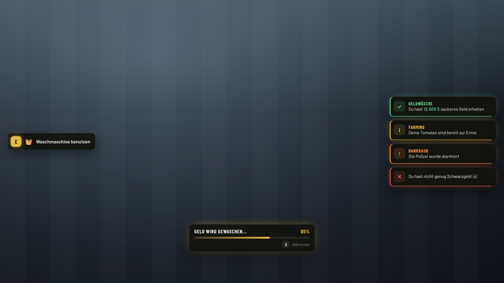
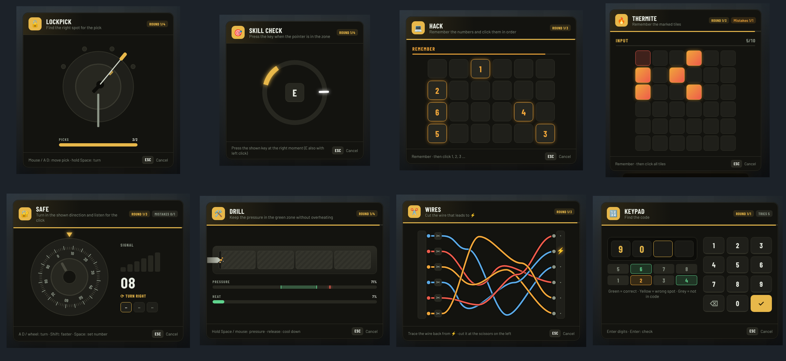

# lafl_lib

Free shared library for FiveM – made for the **LA for Life (LAFL)** scripts, usable in any script.
One bridge for ESX / QBCore / Qbox / standalone, a modern notify, progress bar and text UI, and **8 minigames for robbery scripts**.

**🇩🇪 [Deutsche Anleitung → README.de.md](README.de.md)**





## Features

- **One bridge** – ESX, QBCore, Qbox, standalone · ox_inventory, qb-inventory, ESX inventory · ox_target, qb-target or none.
- **LAFL notify, progress bar, text UI** – works without ox_lib, and with the `extras` folder for **all** your scripts.
- **8 minigames** – lockpick, skill check, hack, thermite, safe, drill, wires, keypad – with a server-side check.
- **Money, dispatch, database, security, Discord logs** and a **UI kit** for your own menus.
- Nothing is auto-detected, nothing is loaded from the internet.

## Installation

1. Unzip the download. Copy the folder `lafl_lib` into `resources` (the name must be exactly `lafl_lib`, not `lafl_lib-main`).
2. `server.cfg` – after framework / inventory / target, **before** the scripts that use it:
   ```cfg
   ensure lafl_lib
   ```
3. Set up `lafl_lib/config.lua`:
   ```lua
   LibConfig.Framework = 'qb'      -- 'esx' | 'qb' | 'standalone'   (Qbox = 'qb')
   LibConfig.Inventory = 'ox'      -- 'ox' | 'qb' | 'esx' | 'custom'
   LibConfig.Target    = 'ox'      -- 'ox' | 'qb' | 'textui' | 'text3d' (no target script needed)
   LibConfig.Notify    = 'lafl'
   LibConfig.Progress  = 'lafl'
   LibConfig.TextUI    = 'lafl'
   LibConfig.Text3D    = 'lafl'    -- 3D text of other scripts: 'lafl' | 'textui' | 'original'
   LibConfig.Locale    = 'en'      -- 'en' | 'de'
   ```
   No ox_target / qb-target? `'textui'` shows "[E] …" at the screen edge, `'text3d'` as a label at the object – for all LAFL scripts at once.
   Several options at one spot show `⇅ 1/2` (option 1 of 2) – switch with the **mouse wheel** or the arrow keys, then press E. Dispatch, company accounts and more are explained in the file. A wrong value is shown in the server console.
4. Restart the server. Test with `LibConfig.Debug = true`: `/lafltest notify`, `/lafltest progress`, `/lafltest textui`, `/lafltest thermite hard`.

LAFL scripts use the LAFL design automatically. For **all other scripts**, follow the next part.

## LAFL design for ALL scripts

Requirement: `LibConfig.Notify`, `Progress` and `TextUI` are set to `'lafl'`.
Below is **everything** per framework. Don't want one part? Just skip that step.

| | ESX | QBCore | Qbox |
|---|---|---|---|
| Notify | folder `esx_notify` | `qb-core/client/functions.lua` | `ox_lib/…/notify.lua` |
| Progress bar | folder `esx_progressbar` | folder `progressbar` | `ox_lib/…/progress.lua` |
| "[E]" hint (text UI) | folder `esx_textui` | `qb-core/client/drawtext.lua` | `ox_lib/…/textui.lua` |
| GTA help box | `es_extended/…/notifications.lua` | – | – |
| 3D text in the world | `es_extended/…/utils.lua` | `qb-core/client/functions.lua` | `qbx_core/modules/lib.lua` |

"Paste below `function …`" means: the new lines go directly under that line, the `function …` line stays exactly once.
Make a backup of every file first. After an update of the framework / ox_lib, do the steps again.

### ESX

1. **Notify, progress bar, text UI:** in `resources`, **delete** `esx_notify`, `esx_textui` and `esx_progressbar`
   (backup outside `resources`) and copy the 3 folders from `extras/esx/` into their place.
2. **GTA help box** ("Press ~INPUT_CONTEXT~ …" top left) – `es_extended/client/modules/ui/notifications.lua`,
   paste below `function ESX.ShowHelpNotification(msg, thisFrame, beep, duration)`:
   ```lua
   if GetResourceState('lafl_lib') == 'started' then return exports.lafl_lib:HelpText(msg, duration) end
   ```
3. **3D text** – `es_extended/client/modules/game/utils.lua`, paste below `function ESX.Game.Utils.DrawText3D(coords, text, size, font)`:
   ```lua
   if GetResourceState('lafl_lib') == 'started' and exports.lafl_lib:DrawText3D(coords, text) then return end
   ```
4. Restart the server.

### QBCore

1. **Progress bar:** in `resources`, **delete** the folder `progressbar` (backup) and copy `extras/qb/progressbar` into its place.
2. **Notify** – `qb-core/client/functions.lua`, search `function QBCore.Functions.Notify`
   and replace the **whole function** (down to its own `end`) with this:
   ```lua
   function QBCore.Functions.Notify(text, texttype, length, icon)
       if GetResourceState('lafl_lib') == 'started' and exports.lafl_lib:GetUIModes().notify ~= 'qb' then
           local title, msg = nil, text
           if type(text) == 'table' then title, msg = text.caption, text.text end
           return exports.lafl_lib:Notify(msg, texttype, { title = title, duration = length })
       end
       local message = { action = 'notify', type = texttype or 'primary', length = length or 5000 }
       if type(text) == 'table' then
           message.text = text.text or 'Placeholder'
           message.caption = text.caption or 'Placeholder'
       else
           message.text = text
       end
       if icon then message.icon = icon end
       SendNUIMessage(message)
   end
   ```
3. **"[E]" hint (DrawText, e.g. qb-garages)** – `qb-core/client/drawtext.lua`.
   Paste below `local function drawText(text, position)` **and** below `local function changeText(text, position)`:
   ```lua
   if GetResourceState('lafl_lib') == 'started' and exports.lafl_lib:GetUIModes().textui ~= 'qb' then return exports.lafl_lib:ShowTextUIAuto(text) end
   ```
   and below `local function hideText()`:
   ```lua
   if GetResourceState('lafl_lib') == 'started' and exports.lafl_lib:GetUIModes().textui ~= 'qb' then
       if exports.lafl_lib:TextUIOwner() == 'script' then exports.lafl_lib:HideTextUI() end
       return
   end
   ```
4. **3D text** – `qb-core/client/functions.lua`, paste below `function QBCore.Functions.DrawText3D(x, y, z, text)`:
   ```lua
   if GetResourceState('lafl_lib') == 'started' and exports.lafl_lib:DrawText3D(x, y, z, text) then return end
   ```
5. Restart the **whole** server (changes in qb-core only work after a full restart).

### Qbox

Do **not** use `extras/qb` – Qbox uses ox_lib. Steps 1–3 also help on QBCore / ESX servers for scripts that use ox_lib.

1. **Notify** – `ox_lib/resource/interface/client/notify.lua`, paste below `function lib.notify(data)`:
   ```lua
   if GetResourceState('lafl_lib') == 'started' and exports.lafl_lib:GetUIModes().notify ~= 'ox_lib' then
       return exports.lafl_lib:Notify(data.description or data.title, data.type, { title = data.description and data.title, duration = data.duration })
   end
   ```
2. **Progress bar** – `ox_lib/resource/interface/client/progress.lua`, paste below `function lib.progressBar(data)` **and** below `function lib.progressCircle(data)`:
   ```lua
   if GetResourceState('lafl_lib') == 'started' and exports.lafl_lib:GetUIModes().progress ~= 'ox_lib' then
       local prop = data.prop and (data.prop.model and data.prop or data.prop[1]) or nil
       return exports.lafl_lib:Progress({
           duration = data.duration, label = data.label, canCancel = data.canCancel == true,
           disable = data.disable or {}, prop = prop,
           anim = data.anim and { dict = data.anim.dict, clip = data.anim.clip, flag = data.anim.flag or 49, scenario = data.anim.scenario },
       })
   end
   ```
3. **"[E]" hint (text UI, also DrawText on Qbox)** – `ox_lib/resource/interface/client/textui.lua`, paste below `function lib.showTextUI(text, options)`:
   ```lua
   if GetResourceState('lafl_lib') == 'started' and exports.lafl_lib:GetUIModes().textui ~= 'ox_lib' then
       if currentText ~= text then exports.lafl_lib:ShowTextUIAuto(text) end
       isOpen, currentText = true, text
       return
   end
   ```
   and below `function lib.hideTextUI()`:
   ```lua
   if GetResourceState('lafl_lib') == 'started' and exports.lafl_lib:GetUIModes().textui ~= 'ox_lib' then
       if exports.lafl_lib:TextUIOwner() == 'script' then exports.lafl_lib:HideTextUI() end
       isOpen, currentText = false, nil
       return
   end
   ```
4. **3D text** (e.g. doors of qbx_properties) – `qbx_core/modules/lib.lua`, paste below `function qbx.drawText3d(params)`:
   ```lua
   if GetResourceState('lafl_lib') == 'started' and exports.lafl_lib:DrawText3D(params) then return end
   ```
5. Restart the **whole** server (`qbx_core/modules/lib.lua` is loaded into every script).

### How the 3D text looks

`LibConfig.Text3D` decides it for all scripts (size and range: `LibConfig.Text3DSettings`):

| Value | Result |
|---|---|
| `'lafl'` | label in the LAFL design at the same place in the world (key boxes, smaller further away) |
| `'textui'` | hints with a key move into the LAFL text UI (nearest one); plain labels stay as LAFL label |
| `'original'` | unchanged, the script draws its own text |

### Good to know

- `E - Open Garage`, `[E] - Exit | [G] - Manage` or `~INPUT_CONTEXT~` are turned into key boxes automatically.
- If the names in the `function …` line of your version differ, use those names in the pasted line.
- Without lafl_lib everything works as before (replacement folders show the plain GTA display).
- `extras/esx` or `extras/qb` you don't need can simply be deleted.

## Troubleshooting

| Problem | Fix |
|---|---|
| `⇅ 1/2` next to the hint (`Target = 'textui'` / `'text3d'`) | Not an error: this spot has 2 options, 1 is selected. Switch with the mouse wheel or the arrow keys, then press E. |
| `lafl_lib is not started` | `ensure lafl_lib` missing or after the script. |
| Other scripts still show the old design | Replacement folder still inside `extras`, or the original folder is still in `resources` too. |
| 3D text still in the old look | Line not pasted at the start of the function, server not restarted, or `LibConfig.Text3D = 'original'`. |
| Only the GTA display | lafl_lib not running, or `LibConfig.Notify` / `Progress` / `TextUI` is not `'lafl'`. |
| Everything twice / game hangs | `LibConfig.Notify` (or `Progress`) points to the framework that you redirected to lafl_lib → set `'lafl'`. |
| QBCore: `attempt to index a nil value (field 'Functions')` | Mistake in `qb-core/client/functions.lua` (often a missing `end`). Restore the backup and replace the whole function again. |

## For developers

```lua
-- fxmanifest.lua
dependency 'lafl_lib'
shared_script '@lafl_lib/init.lua'
-- in your code
LAFL.Require('1.0.0')
```
Without including it, any script can call the exports:
```lua
exports.lafl_lib:Notify('Vehicle locked', 'success', { title = 'Garage' })   -- client
TriggerClientEvent('lafl_lib:notify', src, 'Paid', 'success')                 -- server
exports.lafl_lib:Progress({ duration = 5000, label = 'Repairing', canCancel = true })   -- true / false
exports.lafl_lib:ShowTextUI('Open', { key = 'E' })  /  exports.lafl_lib:HideTextUI()
exports.lafl_lib:DrawText3D(coords, '[E] - Open')   -- every frame, like the GTA text
exports.lafl_lib:Minigame('lockpick', { difficulty = 'easy' })
```

<details>
<summary><b>API reference</b></summary>

**Shared** – `LAFL.Require(v)` · `LAFL.Debug(...)` · `LAFL.Event(name)` · `LAFL.Locale(Config.Locales)` →
`L('key')` · `LAFL.Format.Money / Number / Time / Duration / Coords` · `LAFL.Core.QB() / .ESX()`

**Server**

| Function | Notes |
|---|---|
| `LAFL.Callback.Register(name, fn(src, ...), { cooldown })` | |
| `LAFL.Player.Get / IsLoaded / GetIdentifier / GetName / Coords / List / FromIdentifier` | |
| `LAFL.Player.GetJob(src)` / `.GetGang(src)` | `{ name, label, grade, gradeLabel, onDuty, boss }` |
| `LAFL.Player.HasJob(src, rule, minGrade, onDuty)` / `.HasAccess(src, { jobs, gangs, items, onDuty })` | rule: `'police'`, `{ 'police', 'sheriff' }`, `{ police = 2 }` |
| `LAFL.Inventory.Count / Has / CanCarry / Add / Remove / Slots / Label / Exists` | metadata + slot supported |
| `LAFL.Money.Get / Has / Remove / Add / CanReceive(src, def, amount, reason)` | `{ type = 'item'/'account'/'markedbills', name }`, `'bank'` |
| `LAFL.Money.AddSociety / RemoveSociety / GetSociety` | `LibConfig.Society` |
| `LAFL.Police.Count / IsPolice / List` | |
| `LAFL.Notify(src, msg, type, opts)` | `src = -1` = everyone |
| `LAFL.Dispatch.Send(src, coords, alert)` | |
| `LAFL.DB.Query / Single / Scalar / Insert / Update / Transaction / EnsureTable` | oxmysql |
| `LAFL.Security.InRange / Coords / Lock / Unlock / WithLock / SetCooldown / GetCooldown / RateLimit / Flag` | |
| `LAFL.Log(src, action, data)` | Discord in `config_server.lua` |
| `LAFL.Minigame.Await(src, game, opts)` | one-time token + minimum time |

**Client**

| Function | Notes |
|---|---|
| `LAFL.Callback.Await / Trigger` | |
| `LAFL.Player.Data / GetJob / GetGang / HasJob / OnLoaded / OnUnloaded / OnJobChange` | |
| `LAFL.Inventory.Count / Has / ImagePath / Image` | |
| `LAFL.Notify(msg, type, opts)` | `inform` · `success` · `error` · `warning`, `**bold**`, GTA colours `~g~` |
| `LAFL.Progress({ duration, label, anim, prop, canCancel, disable })` | `true` / `false` |
| `LAFL.TextUI.Show(text, { key, icon }) / Hide / IsOpen` | |
| `exports.lafl_lib:ShowTextUIAuto(text)` / `HelpText(text, ms)` / `GetUIModes()` | key from `[E]`, `E - …`, `~INPUT_CONTEXT~` |
| `exports.lafl_lib:DrawText3D(coords, text)` | 3D label, call every frame; `false` = `Text3D` is `'original'` |
| `LAFL.Anim.Play / Stop / AttachProp` | `{ dict, clip, flag }` or `{ scenario }` |
| `LAFL.Target.AddEntity / AddModel / AddSphere / AddBox / AddGlobal` (+ Remove) | ox_target / qb-target / text UI |
| `LAFL.World.AddPed / AddProp / SpawnPed / SpawnProp / AddBlip / StreetName / CoordsCommand` | |
| `LAFL.Dispatch.Send(coords, alert)` | |
| `LAFL.Minigame.Start(game, opts)` | `true` won / `false` lost |

**Minigames:** `lockpick` · `skillcheck` · `hack` · `thermite` · `safe` · `drill` · `wires` · `keypad` –
options `difficulty = 'easy' | 'medium' | 'hard'`, `rounds`, `time`, `title`. Use `LAFL.Minigame.Await` on the server whenever there is a reward.

**UI kit:** `nui://lafl_lib/web/lafl.css` + `nui://lafl_lib/web/lafl.js` (`window.LAFLUI`) – LAFL design and fonts for your own menus.
</details>

## License

**GNU LGPL-3.0** (see `LICENSE`; it builds on the GPL-3.0 in `COPYING`). Free to use in free and paid scripts. If you change lafl_lib itself and share it,
your changes must stay open under the same license and keep the credits.

Fonts: Barlow by Jeremy Tribby, [SIL Open Font License](web/fonts/OFL-Barlow.txt). Made by Gstar8417 for LA for Life.
